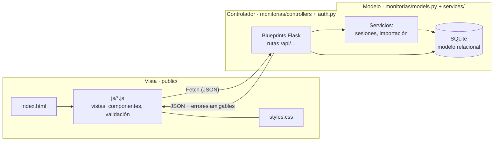
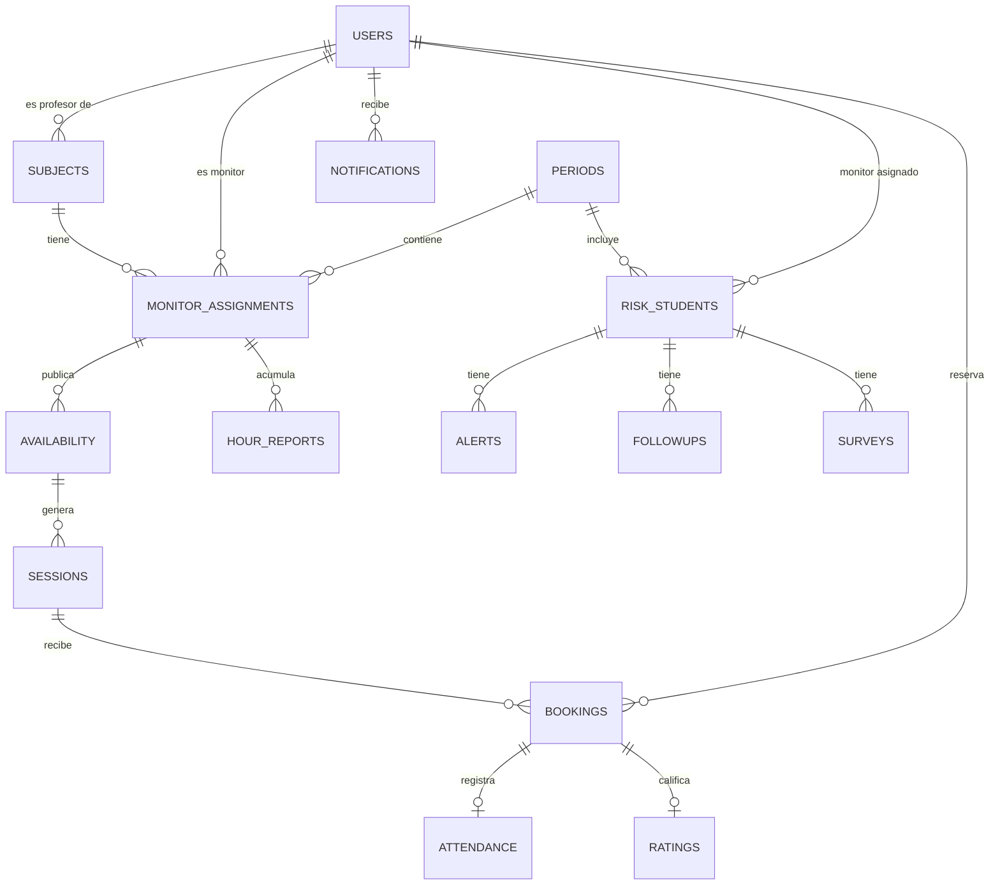

# Sistema de Monitorías Académicas · UCC

Aplicación web **Full Stack** para gestionar monitorías académicas: oferta y reserva de sesiones, control de asistencia, horas de los monitores y acompañamiento de estudiantes en riesgo (alertas tempranas, seguimientos, encuestas e importación de reportes DARP).

Proyecto final del curso *Herramientas Computacionales* · Ingeniería de Sistemas · Universidad Cooperativa de Colombia, sede Montería.

## Problema y objetivos

**Problema:** la gestión de monitorías se hacía de forma manual (hojas de cálculo y mensajes), sin control de cupos, de asistencia ni de las horas que se pagan a los monitores, y sin trazabilidad del acompañamiento a los estudiantes en riesgo.

**Objetivos**
1. Centralizar la oferta de monitorías y automatizar reservas, cupos y asistencia.
2. Calcular las horas de cada monitor desde las sesiones cerradas y permitir su aprobación por el profesor.
3. Registrar alertas, seguimientos y encuestas de ausentismo de los estudiantes en riesgo, con reportes exportables.
4. Ofrecer una interfaz clara, validada y adaptable a celulares, con permisos por rol.

## Tecnologías

| Capa | Tecnología |
|---|---|
| Backend | Python 3.10+ y **Flask** (fábrica de aplicación + Blueprints) |
| Base de datos | **SQLite** (modelo relacional con llaves primarias, foráneas, `UNIQUE` y `CHECK`) |
| Frontend | HTML5 semántico, CSS3 (+ Bootstrap 5.3.3 local), JavaScript (Fetch API, sin frameworks) |
| Seguridad | PyJWT en cookie `httpOnly`, contraseñas con hash (Werkzeug), validación en cliente y servidor |
| Reportes | OpenPyXL (Excel) y `zipfile` |
| Pruebas | pytest (backend) |

## Arquitectura (MVC)



| Componente | Archivos |
|---|---|
| **Modelo** | `monitorias/models.py` (esquema, conexión, notificaciones), `monitorias/services/` (generación de sesiones, lectura de CSV/XLSX) |
| **Controlador** | `monitorias/auth.py` y `monitorias/controllers/` (`student`, `monitor`, `teacher`, `risk`, `admin`, `general`) |
| **Vista** | `public/index.html`, `public/styles.css`, `public/js/` |
| Configuración | `monitorias/config.py`, `.env` |

## Modelo de datos



## Estructura del proyecto

```
app.py                      punto de entrada (python app.py)
seed.py / reset.py          datos de demostración / reinicio de la base
monitorias/
  __init__.py               fábrica create_app(), registro de blueprints y manejo de errores
  config.py  models.py  utils.py  auth.py
  controllers/              student · monitor · teacher · risk · admin · general
  services/                 sessions.py (sesiones recurrentes) · imports.py (CSV/XLSX)
public/
  index.html  styles.css  logo_ucc.png  vendor/bootstrap.min.css
  js/                       core · ui · views-* · main
tests/                      pruebas de humo y de regresión (pytest)
```

## Instalación

Requisitos: Python 3.10 o superior.

**Windows (PowerShell)**
```powershell
python -m venv .venv
.venv\Scripts\Activate.ps1
python -m pip install -r requirements.txt
Copy-Item .env.example .env
```

**Linux / macOS**
```bash
python3 -m venv .venv && source .venv/bin/activate
pip install -r requirements.txt
cp .env.example .env
```

Edita `.env` y reemplaza `JWT_SECRET` por una cadena aleatoria de **al menos 32 caracteres** (el valor de la plantilla no deja iniciar el servidor).

| Variable | Descripción | Valor local |
|---|---|---|
| `PORT` | Puerto del servidor | `3000` |
| `JWT_SECRET` | Clave para firmar la sesión (≥ 32 caracteres) | propia |
| `COOKIE_SECURE` | `true` solo si el sitio usa HTTPS | `false` |
| `DEMO_MODE` | Modo de pruebas (ver abajo) | `true` |

Cargar datos de demostración y ejecutar:
```powershell
python seed.py
python app.py
```
Abre <http://127.0.0.1:3000>.

### Modo de pruebas (`DEMO_MODE=true`)

Pensado para la versión de prueba y la sustentación: **se desactivan las reglas que dependen de la fecha** para que todas las opciones de cada cuenta estén disponibles. Así se puede reservar o cancelar cualquier sesión, marcar asistencia y cerrar sesiones futuras, y calificar de inmediato. Además muestra la contraseña demo en el inicio de sesión y permite crear usuarios sin clave inicial (usan `Demo1234!`). Con `DEMO_MODE=false` rigen las reglas reales (no reservar sesiones pasadas, no cerrar sesiones futuras, etc.).

## Usuarios de demostración

Contraseña de todos: `Demo1234!`

| Correo | Rol |
|---|---|
| maria.perez@ucc.edu.co · carlos.mejia@ucc.edu.co | Estudiante |
| laura.gomez@ucc.edu.co · diego.vargas@ucc.edu.co | Monitor |
| andres.ruiz@ucc.edu.co | Profesor |
| camila.torres@ucc.edu.co | Coordinador |
| admin@ucc.edu.co | Administrador |

## Funcionalidades por rol

- **Estudiante:** busca monitorías (búsqueda, filtros y paginación), reserva y cancela, califica sesiones a las que asistió.
- **Monitor:** publica y edita su disponibilidad semanal (genera sesiones para 4 semanas), marca asistencia, cierra sesiones, consulta sus horas, ve a sus estudiantes y registra seguimientos con evidencia.
- **Profesor:** asigna monitores a sus asignaturas, aprueba o rechaza reportes de horas, consulta indicadores y registra alertas tempranas.
- **Coordinador:** importa reportes DARP (CSV/XLSX con vista previa y mapeo de columnas), reparte estudiantes entre monitores, consulta seguimientos, registra encuestas y exporta el reporte final en ZIP.
- **Administrador:** CRUD de usuarios y roles, asignaturas, periodos y catálogos; indicadores.
- **Todos:** notificaciones internas, cambio de contraseña, sesión segura.

## Cumplimiento de los lineamientos y la rúbrica

| Criterio | Cómo se cumple |
|---|---|
| Backend Flask, MVC, rutas, controladores | Fábrica de aplicación, 7 blueprints, capa de modelo y servicios separados |
| CRUD completo | Usuarios, asignaturas, periodos, catálogos, disponibilidad, seguimientos, alertas, encuestas y asignaciones |
| Validaciones y errores | Cliente (JS, mensajes bajo cada campo) y servidor (Python); errores en JSON amigable, **nunca un Traceback** |
| Feedback visual | Toasts de éxito/error y modales de confirmación propios (sin `alert()` ni `confirm()`) |
| Campos obligatorios | Todos los formularios marcan con **\*** los campos obligatorios y explican la leyenda |
| Paginación y filtros | Listados con búsqueda dinámica, filtros y paginación; estudiantes en riesgo paginados desde el servidor |
| Base de datos relacional | SQLite con PK, FK, `UNIQUE` y `CHECK`; persistencia inmediata |
| Renderizado dinámico | Toda la información se obtiene por Fetch desde `/api/...`; el HTML no contiene datos estáticos |
| Diseño y UX | Paleta institucional, responsive, navegación por rol, animaciones suaves (`prefers-reduced-motion`) |
| Ortografía | Interfaz y mensajes revisados con corrector ortográfico |

## Pruebas

```powershell
python -m pyflakes monitorias app.py seed.py reset.py
python -m pytest
```

Para reiniciar los datos: detén el servidor y ejecuta `python reset.py` y luego `python seed.py`. La base queda en `data/`, las evidencias en `uploads/`; **no subas `.env`** al repositorio.
